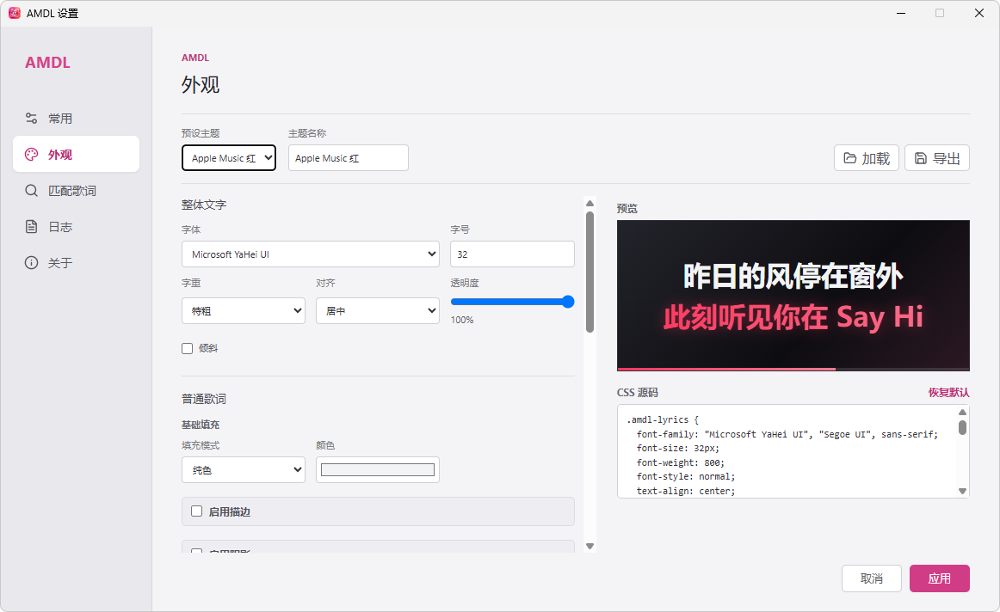
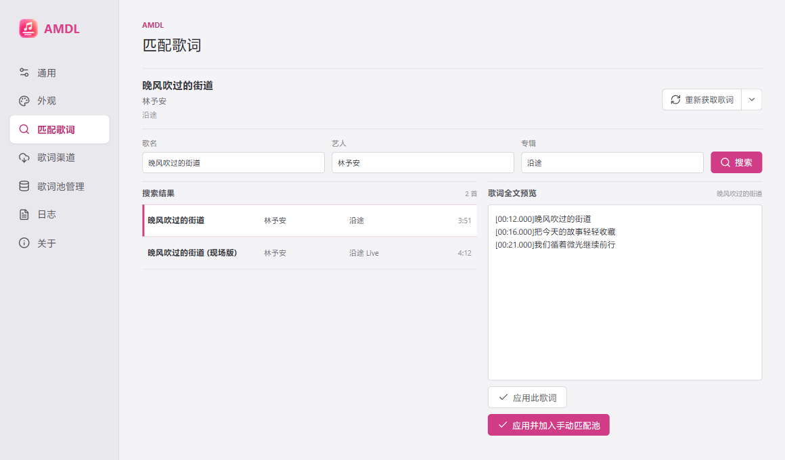
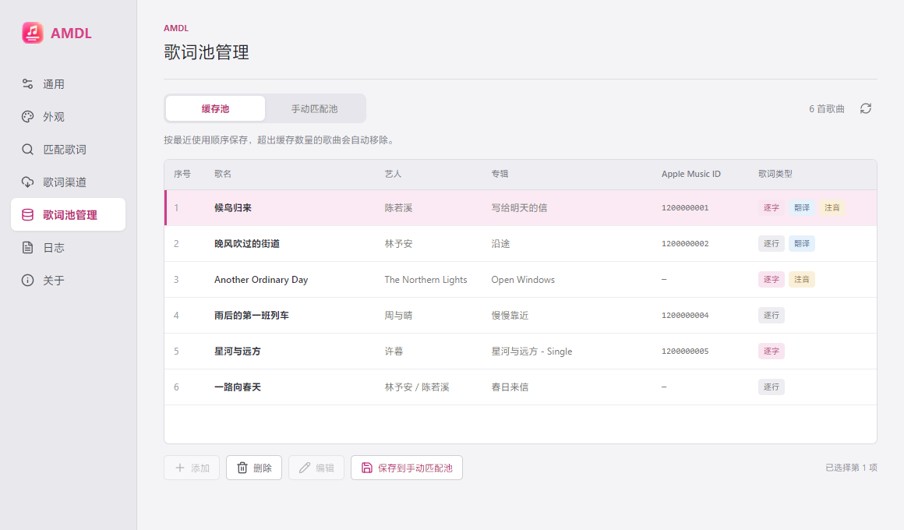
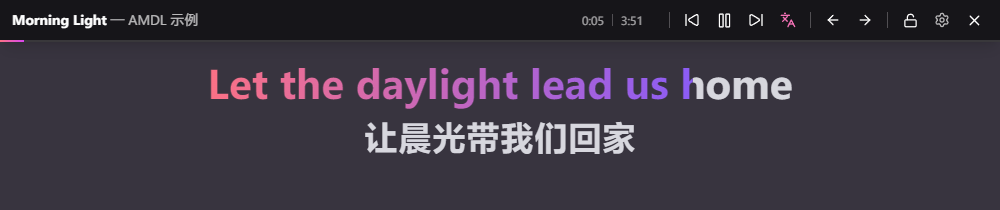
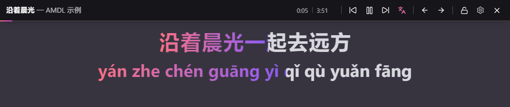

<div align="center">


# Apple Music Desktop Lyrics (AMDL)

**专为 Windows 版 Apple Music 打造的现代化桌面歌词工具**

[](#)
[](#)
[](#)
[](#)
[](#)
[](https://github.com/ElliottZhao666666/AM-Desktop-Lyrics/releases/tag/v1.0.2)

[官网 (amdl.ybjun.com)](https://amdl.ybjun.com) • [反馈 Bug](mailto:main@ybjun.com) • [提交特性请求](https://github.com/ElliottZhao666666/AM-Desktop-Lyrics/issues/new)

</div>

---

## ✨ 简介

Windows 原生 Apple Music 客户端虽然体验优秀，但一直缺失国人习惯的“桌面悬浮歌词”功能。**AMDL (Apple Music Desktop Lyrics)** 旨在填补这一空白。

借助系统级 SMTC 媒体监听，结合 Rust + Tauri 架构，AMDL 同步读取歌曲信息与播放状态，为你提供可自定义外观的桌面歌词。当前正式版本为 **1.0.2**，适用于 Windows 10 / 11，支持新版 Apple Music 的逐字缓存、官方翻译与注音。

## 🚀 核心特性

- **原生媒体同步**：通过 SMTC 读取播放状态，结合歌曲名称、艺人、专辑、时长及客户端缓存核验当前曲目；Apple Music 在线搜索与缓存核验相互补充，同等候选可通过缓存 ID 消歧。播放时平滑推进高亮，正常同步不会让歌词反复回跳。
- **高度视觉自定义**：
  - 🎨 彻底解耦的外观配置，支持多种效果。
  - 📂 支持选择系统字体或填写已安装的字体名称，支持导出导入 `.amdlcss` 主题文件。
  - 🎁 内置多款预设主题（暖橙日落、青绿森林、海蓝霓虹、纯白极简等）。
- **歌词获取与解析**：
  - 🎤 支持 TTML **逐字歌词**、TTML 逐行歌词和 LRC，兼容多时间标签、offset 及主句和和声的重叠时间轴。使用 Apple Music API 歌词前，请按 [AM API Token 获取教程](https://amdl.ybjun.com/help/get-token/) 配置 Token。
  - 🔍 提供 **Apple Music API、Apple Music 本地缓存、QQ 音乐**渠道，按配置的启用状态和优先级获取；本地缓存指 Apple Music 客户端缓存，与 AMDL 缓存池相互独立。
  - 🎵 兼容旧版 `ttmlLyrics` 缓存和 Apple Music 1.7 的 `syllable-lyrics` 缓存，根据实际时间标签显示逐字或逐行歌词。
  - 🌐 支持官方翻译与注音，辅助行跟随对应主句；有逐字时间的注音可整行连续高亮。可设置默认关闭、优先翻译或优先注音，并从控制条切换。两项手动开关在本次运行中分别保留，切歌继续生效；两项均手动开启时优先显示翻译，重启后恢复配置默认值。
  - 🔑 开发者 Token 可在歌词渠道设置中手动检测声明的到期时间；检测在本机完成，不代表服务器授权校验。
  - 🔁 通用设置可配置获取失败后的最大自动重试次数（0–5，默认 3）；每次间隔 15 秒，换歌或手动重新获取后重新计数。
  - 🛠️ **匹配歌词**页面支持 QQ 音乐搜索、歌词预览、“应用此歌词”和“应用并加入手动匹配池”；“重新获取歌词”可重走完整流程，也可从下拉菜单指定单一渠道。
  - 🗂️ **歌词池管理**提供“缓存池”和“手动匹配池”。缓存池按最近使用顺序保留 1–50 首歌曲；减少上限并应用后立即裁剪。可将缓存保存到手动匹配池，再添加、编辑或删除歌词；保存前校验并解析 TTML / LRC。支持显示与查询 Apple Music 歌曲 ID，并保存翻译、注音数据与对应类型标签。
  - 🌏 支持繁体歌词自动转简体，以及可即时预览并保存的歌词时间偏移。
  - ✨ 逐字歌词共用整行渐变，和声可独立高亮；逐行歌词在句间保持高亮，尾奏保留最后一句，长间奏继续显示三个点。
- **沉浸式交互**：
  - 🖱️ 锁定后启用**鼠标穿透**；鼠标移到歌词面板顶部可显示解锁按钮，也可通过托盘解锁。
  - 🎛️ 悬浮控制条无缝集成切歌、暂停等媒体控制。
  - 📌 支持记忆位置和大小、保持歌词面板置顶，以及一键将面板恢复到主显示器的默认位置。
- **运行与维护**：
  - 📝 内置双文件轮转日志，记录歌曲识别与歌词渠道获取结果，方便排错与追溯。
  - 🔄 支持启动检查与“关于 → 检查更新”，确认后下载并校验更新签名。正式安装包和 Debug 测试版均不弹出 CMD 日志窗口。

## 📸 界面预览


<table>
  <tr><th width="50%">桌面歌词效果</th><th width="50%">外观设置</th></tr>
  <tr>
    <td></td>
    <td></td>
  </tr>
  <tr><th>匹配歌词</th><th>歌词池管理</th></tr>
  <tr>
    <td></td>
    <td></td>
  </tr>
  <tr><th>官方翻译</th><th>逐字注音</th></tr>
  <tr>
    <td></td>
    <td></td>
  </tr>
</table>

截图使用示例曲目展示界面；实际歌词与逐字时间轴取决于对应渠道提供的内容。

## 📥 安装与使用 (Installation & Usage)

### 下载
前往 [Releases](https://github.com/ElliottZhao666666/AM-Desktop-Lyrics/releases) 页面下载最新版本的安装包：
- 下载 **Windows x64 `.exe` 安装程序**并安装；升级时建议先退出旧版。
- 系统需安装 Microsoft Edge WebView2 Runtime；安装程序会检查运行环境。
- Release 中的 `.sig` 和 `latest.json` 用于自动更新，无需手动打开。

### 快速开始
1. 确保你的电脑已开启并正在运行 Windows 版 **Apple Music**。
2. 启动 **AMDL**。
3. 播放任意歌曲，歌词窗口将自动吸附在主显示器底部正中。
4. **控制与设置**：将鼠标悬停在歌词区域上方，唤出控制条点击 ⚙️ 进入设置；或者在系统右下角托盘图标处右键进入。
5. **锁定窗口**：在系统托盘右键菜单中勾选“锁定窗口”，即可实现鼠标穿透；鼠标移到歌词面板顶部时会显示解锁按钮。
6. **窗口置顶与位置**：托盘菜单和“设置 → 通用”均可切换“保持歌词面板置顶”，默认开启并记忆选择；托盘菜单中的“重置歌词面板位置”会恢复主显示器上的默认大小和位置。
7. **歌词渠道**：在“设置 → 歌词渠道”配置渠道开关与 Apple Music API Token；配置方法见 [Token 获取教程](https://amdl.ybjun.com/help/get-token/)。Token 仅保存在本机配置中，请勿分享给他人。
8. **匹配与管理**：遇到错误歌词时，在“匹配歌词”搜索并应用；希望后续优先使用时选择“应用并加入手动匹配池”。在“歌词池管理”中可查看缓存、保存到手动匹配池并编辑，缓存池本身不支持直接编辑。
9. **翻译与注音**：歌词包含对应内容时，控制条会出现翻译图标；点击切换，有两种内容时可从菜单分别开关。默认显示偏好与获取失败最大重试次数可在“设置 → 通用”调整，完整说明见 [快速入门](https://amdl.ybjun.com/help/quick-start/)。

## 🛠️ 本地开发 (Development)

本项目基于 Tauri v2 架构开发，前后端分离。

**环境要求：**
- Node.js 22+ & pnpm 10
- Rust 1.90+ 工具链 (cargo)
- Visual Studio C++ 构建工具、Windows SDK 与 WebView2 Runtime

**构建步骤：**
```bash
# 1. 克隆代码仓库
git clone https://github.com/ElliottZhao666666/AM-Desktop-Lyrics.git
cd AM-Desktop-Lyrics

# 2. 安装前端依赖
pnpm install --frozen-lockfile

# 3. 本地开发调试
pnpm tauri dev

# 4. 检查前端构建并运行 Rust 测试
pnpm build
cargo test --manifest-path src-tauri/Cargo.toml --lib

# 5. 编译 Release 版本
pnpm tauri build
```

正式更新产物必须使用与 `src-tauri/tauri.conf.json` 公钥配对的私钥签名。可设置 `TAURI_SIGNING_PRIVATE_KEY` 和 `TAURI_SIGNING_PRIVATE_KEY_PASSWORD` 后构建，或使用已配置签名 Secret 的 Release 工作流。签名私钥与 Token 不应提交到仓库。

官网使用静态 HTML 公共框架；修改 `site/partials/` 后运行 `pnpm site:build`，通过 `pnpm site:check` 核对。帮助文章位于 `docs/help/`。

更新服务源码位于 `services/update-worker/`，使用 Cloudflare Worker `ybjun-update`、域名 `update.ybjun.com` 和 D1 数据库 `ybjun-software-update`。修改服务时先执行本地检查并应用 D1 增量迁移，再部署 Worker。发布新版本时，先上传并验证安装包及其 `.sig`，再将版本、下载地址、完整签名、更新日志和 UTC 发布时间写入 D1，最后切换对应平台的 `is_latest` 标记。

## 🗺️ 路线图

- [x] 核心 SMTC 状态监听与播放时间同步模型

- [x] 动态无边框透明窗口

- [x] 缓存池、Apple Music API、本地缓存与 QQ 音乐歌词获取

- [x] 多格式歌词解析与展示

- [x] 新版 Apple Music 逐字缓存、官方翻译与注音显示

- [x] 主题外观配置、系统字体与 CSS 编辑

- [x] 自动繁体转换和偏移调节

- [x] 双文件轮转本地日志系统

- [ ] 固定双行歌词展示（当前重叠主句、和声可同时显示）

- [x] TTML 逐字解析、整行渐变和渐进高亮；当前行定位使用二分查找

- [ ] 平滑滚动和更多展示模式

- [x] 多款内置主题与自定义 CSS 导入导出

- [x] 匹配歌词、手动匹配池、缓存管理与歌词编辑

- [x] 鼠标穿透、顶部解锁、置顶设置与主屏位置重置

- [x] 更新检查、签名校验与 Windows 安装包发布

- [ ] 集成 AMLL-DB、网易云和更多歌词渠道

......

## 🤝 贡献与反馈
欢迎提交 Issue 报告 Bug 或分享你的灵感，也随时欢迎提交 Pull Request 一起完善 AMDL！如果在歌词匹配或主题样式上有好的想法，请不要犹豫。

## 📄 许可
本项目采用 MIT License 协议开源。

## Made with ❤️ by [月半菌](https://www.ybjun.com)
