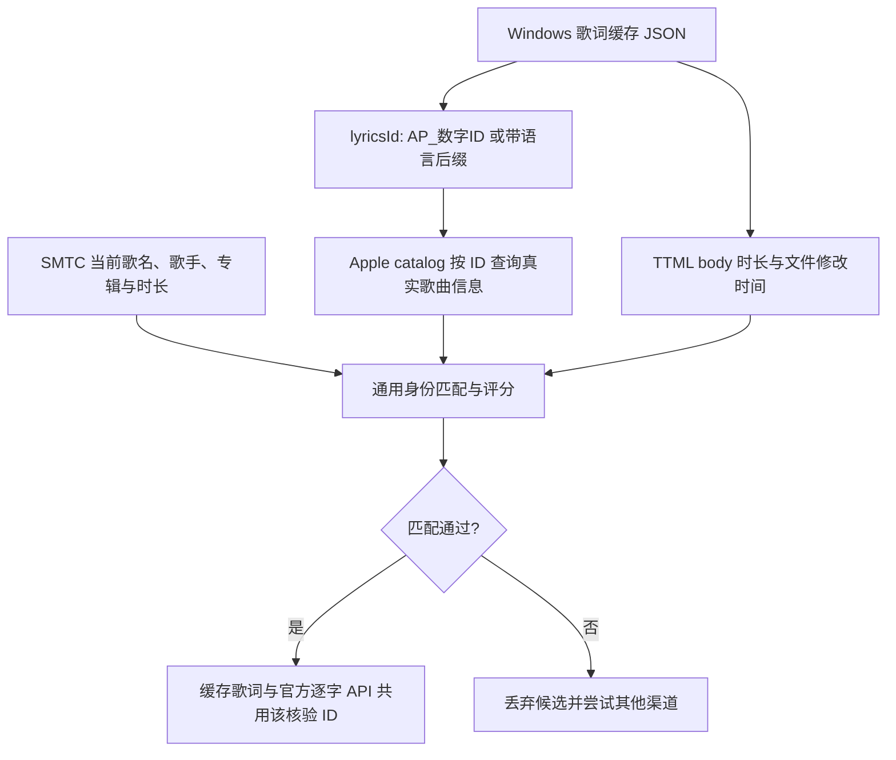

# 逐字渐变、连续时钟与歌曲 ID 核验

本轮修复两个实机问题：逐字高亮的渐变重复，以及正常播放时高亮前后跳动。页面布局和主题控件保持不变。修复后提交中文 commit，再编译 Windows 测试版。

## 一、为什么原来的渐变是“一字一条”

旧渲染器为每个词创建普通字形和高亮字形。每个高亮元素都带 `.amdl-lyric-line.is-active`，各自应用 `linear-gradient(...)`。浏览器按每个元素自己的盒子铺背景，因此十个词就出现十次起始色到结束色。

新渲染器 `KaraokeLine.vue` 每行只创建两套完整文本：普通层、高亮层。全部高亮词共用高亮层的一个渐变背景，再用 SVG 裁剪路径控制每个词显示多少。高亮背景的宽度等于当前高亮区域最右侧的位置：已高亮区域不论长短，都从起始色到结束色完整铺一条渐变。

单词进度仍为：

```text
progress = clamp((播放位置 - word.begin_ms) / (word.end_ms - word.begin_ms), 0, 1)
```

进度决定遮罩，颜色由整行背景决定。两者分工明确，不依靠每个词独立绘制背景。

位置测量使用浏览器 `DOMRange.getClientRects()`：沿着完整文本节点测量词元范围，保留字体实际宽度、英文空格、字距和换行。不能用“字符数 / 全行字符数”代替宽度，因为 `I`、`W`、中文、空格宽度不同。测量只在歌词、字体或尺寸变化时执行，播放每帧只更新裁剪路径和背景宽度。

普通层使用高亮区域的补集，高亮层使用高亮区域本身，避免重叠字形产生双重描边。遮罩外沿保留阴影、描边和发光空间。暂停时父容器缩放到 95%，测量结果会换回元素本地坐标，不把屏幕坐标直接当作裁剪坐标。

换行仍使用同一背景坐标空间；每个词的跨行矩形分别裁剪，整个高亮元素没有为每个词创建新渐变。

## 二、跳动的实机证据与时钟修复

只读采集 Apple Music 播放“惊鸿一面”时的 SMTC 样本，未执行播放、暂停或切歌。观测到了：

```text
raw=42000ms，时间戳年龄=133ms → 估算=42133ms
约半秒后：raw 仍为 42000ms，时间戳年龄=91ms → 估算=42092ms
```

位置仍停留在整秒，时间戳却刷新了。旧前端每次用新估算值修正锚点：小误差直接加 `drift × 0.35`，超过 300ms 则直接跳到 SMTC 值。上一帧已经推进到更远位置时，这两条路径都可能让高亮倒退。

微软将 [LastUpdatedTime](https://learn.microsoft.com/en-us/uwp/api/windows.media.control.globalsystemmediatransportcontrolssessiontimelineproperties.lastupdatedtime?view=winrt-26100) 定义为时间轴属性的最后更新时间；它并不承诺给出每帧、每毫秒准确的音频位置。不能把每次时间戳刷新都当成播放器已经给出一个新的精确播放位置。

新链路分为两层：

1. **Rust 时间轴跟踪。** 同一份样本只建立一次时间锚点，以 `Instant` 推进；Position 不变、只有时间戳刷新的样本保留连续锚点。暂停冻结计时，恢复不累计暂停时间。较早样本不覆盖较新样本。Position 改变但时间戳没有变化时，不重复叠加旧时间戳的年龄。
2. **前端连续时钟。** `PlaybackClock` 使用 `performance.now()` 和 `requestAnimationFrame` 推进。新 SMTC 位置是校准目标；正常播放时不立即修改当前显示位置，而是通过轻微调速收敛误差。

每帧的简化形式是：

```text
预测位置 = 上次位置 + dt × 播放速度
误差 = 校准目标在当前时刻的位置 - 预测位置
修正量 = clamp(误差 × (1 - exp(-dt / 800ms)), -0.2 × dt × 速度, +0.2 × dt × 速度)
显示位置 = 预测位置 + 修正量
```

8ms 以内误差忽略。正常校正时速度在原播放速度的 80%～120% 之间，所以在正常正向播放中显示位置不会倒退，也不会因一次校准直接跃进一大段。IPC 传输附带采样时刻，补偿本机消息排队延迟；逐帧推进仍使用单调时间。

### 真实 seek 如何保留

并没有对所有倒退一律取 `max`。那样会使真正向后拖动进度条失效。

Rust 在新时间轴样本中比较“本应自然推进到的位置”与新位置，差异超过 1.5 秒时标记重新定位；首个有效样本和切歌也重新建立锚点。前端遇到这些情况立即采用新位置。订阅 [TimelinePropertiesChanged](https://learn.microsoft.com/en-us/uwp/api/windows.media.control.globalsystemmediatransportcontrolssession.timelinepropertieschanged?view=winrt-26100) 后，seek 不必只等下一次 1 秒轮询。

重新定位计数 `timeline_revision` 持续附在后续进度中：即使某次 seek 事件没有被前端处理，下一条进度仍能触发重定位。重复 IPC revision 会被拒绝，避免同一跳转快照被二次应用。

低于识别阈值的极小 seek 可能按普通误差平滑跟随。SMTC 提供的位置本身存在量化，本轮保证显示连续性与明显跳转恢复，不宣称它具备音频采样级精度。

## 三、当前歌曲信息与 ID 究竟从哪里来

目前不是从 SMTC 直接读取 Apple Music catalog ID。SMTC 提供的是歌名、歌手、专辑、播放状态和时间轴；catalog ID 来自客户端歌词缓存的 `lyricsId`，之后必须经过歌曲身份核验。



缓存 JSON 通常有 `lyricsId`、`ttml`、`status`，没有可直接用于匹配的歌名和歌手。`AP_6814997425-en` 会取出数字 ID `6814997425`；`-en` 属于语言后缀，不属于歌曲 ID。

随后按该 ID 查询 Apple catalog，获取真实 `name`、`artistName`、`albumName`、`durationInMillis`。catalog 无可用结果时尝试 iTunes lookup；查过的元数据保存在本地，以便重复使用。缓存里的 ID 本身只证明这份歌词的来源，不能证明它属于当前正在播放的歌曲。

### 通用评分与必要条件

| 项目 | 得分与规则 |
| --- | --- |
| 歌名 | 规范化后相同 50 分，且必须匹配。 |
| 歌手 | 名称集合相同 30 分；当前歌手集合是候选集合的子集 25 分；其余拒绝。 |
| 专辑 | 相同 10 分；某一侧未知 5 分；不同 0 分。不同合辑不必直接拒绝。 |
| 时长 | 相差 ≤1s 得 10 分；≤4s 得 8 分；≤8s 得 3 分；未知 5 分。已知时长相差 >8s 拒绝。 |
| 版本 | Live、Remix、Instrumental/Karaoke、Acoustic、Demo 等已识别标记冲突时拒绝。 |

总分至少 80，同时满足歌名、歌手、版本和时长的必要条件。规范化包括大小写、标点空格、繁简处理；多歌手以集合比较，避免顺序差异和“Li 包含在 Lily 中”这类错误的子串匹配。

Apple 缓存还叠加两项更严格的核对：TTML body 时长与 catalog 时长相差不超过 4 秒，且与已知 SMTC 时长相差不超过 4 秒。文件时间只用于通过身份核验的候选之间排序：新鲜度加权低于身份评分，修改时间再作同分排序。上一首即使文件更近、时长相同，也不能绕过歌名和歌手检查。

### 官方逐字歌词为什么不会再沿用上一首 ID

两个 Apple 渠道共用 `VerifiedCache`：先验证缓存候选属于当前歌，再把同一个数字 ID用于 `/songs/{id}/syllable-lyrics`，不单独再猜一次 ID。响应中已知时长不符仍会拒绝。

同时每次检索携带歌曲版本和请求代数。A→B→A 即使歌名最终又相同，最初 A 的迟到请求也不能覆盖新的 A，更不能写进 B 的缓存。

这提高的是匹配可信度。没有对应缓存或没有可核验元数据时，Apple 官方逐字渠道目前无法自动获得该 ID，会按配置尝试其他渠道；极相似的重录版本仍可能需要用户手动纠正。QQ 自动匹配已使用同一个评分模块，后续网易云也可以复用。

## 验证与源码入口

- `pnpm test`：增加每帧不倒退、校准无跳变、明显 seek、暂停恢复、倍速、遗漏 seek 事件与重复快照；遮罩覆盖真实宽度、长词、空格与换行。
- Rust 单测：覆盖同样本、只刷新时间戳、UTC 变化、暂停恢复、迟到样本及重新定位版本。
- `pnpm build`：类型检查及生产构建。
- 可选真实浏览器回归：`scripts/fixtures/karaoke.html` 与 `scripts/test-karaoke-browser.cjs`，验证六个预设、中英文、换行、字体变化和暂停缩放。Playwright 使用本机已有运行库，未新增应用依赖。
- SMTC 实机只读采样已运行，证实了整秒 Position 与独立刷新时间戳造成的倒退估算。
- 最终重复采样时 Apple Music 会话已经关闭，因此未完成第二次 6 秒采样；该条件下诊断测试因缺少会话失败。相同场景的样本回放单测、51 项 Rust 离线测试及浏览器回归通过，最终桌面连续播放体验仍由新测试版验收。

主要文件：`src/components/KaraokeLine.vue`、`src/karaoke.ts`、`src/playback-clock.ts`、`src-tauri/src/media/smtc.rs`。歌曲身份路径见 `lyrics/cache_scanner.rs`、`lyrics/am_api.rs`、`lyrics/matching.rs`、`lyrics/cache.rs` 与 `lyrics/provider.rs`。
